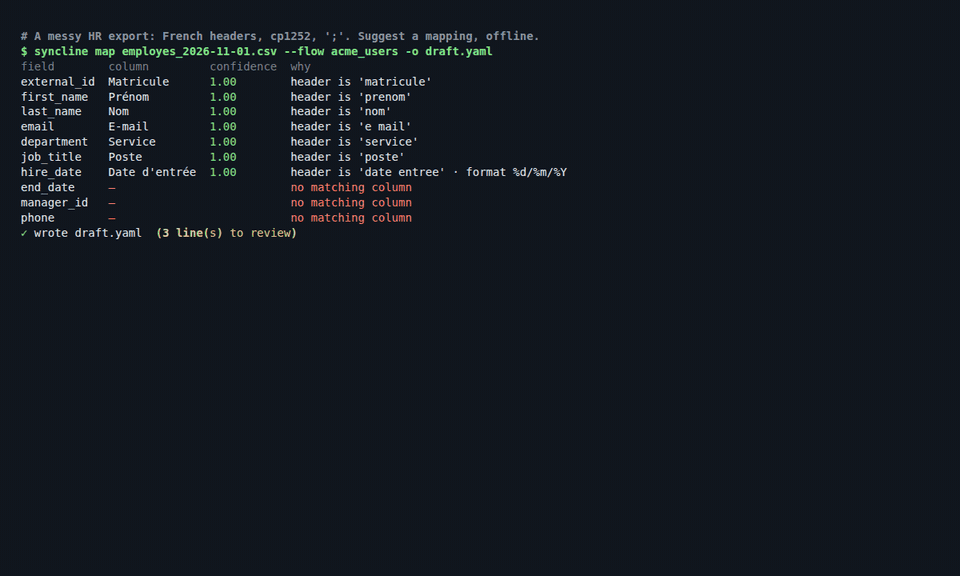

<div align="center">

# 🔁 Syncline

### Describe a data sync in a YAML file instead of writing a script.

Your customers send their data as messy CSV and Excel exports. Syncline maps them to your schema,<br/>
rejects bad rows with a reason, shows exactly what will change, and loads only that.

<br/>

[](https://github.com/MedAmine-SUDO/syncline/actions/workflows/ci.yml)
&nbsp;

&nbsp;


<br/>



</div>

<br/>

## ✨ Why Syncline?

Every B2B product that imports customer data ends up with the same pile of scripts: one per customer, each with its own column names, date formats and rules, each failing in its own way. The usual signs:

- a customer's export has **French headers, `;` separators and Windows-1252 accents**, and the script breaks;
- a row with a missing e-mail **crashes the whole import**, or worse, loads silently;
- a **half-exported file** deactivates half the company before anyone notices;
- nobody can say **what an import changed** last Tuesday.

**Syncline replaces those scripts with one engine and one small YAML file per customer:**

- 🗺️ **Map, don't code**: rename, trim, type and translate columns in YAML. `syncline map` drafts it for you.
- 🛑 **Bad rows are rejected, not loaded**: each one comes back with the reason and its original values.
- 👀 **See it before it happens**: `--dry-run` shows the exact creates, updates and deactivations. The real run applies that same diff.
- 🛡️ **Guards against disasters**: a file that would deactivate a big share of your records stops before writing anything.
- 🧾 **Every run is on record**: what changed, from what to what, and which rows were rejected, with a report you can send to the customer.

<br/>

## 🚀 Features

<table>
<tr>
<td width="50%" valign="top">

### 🗺️ Offline mapping assistant
`syncline map export.csv` matches columns to fields by name (English and French synonyms, accents and punctuation ignored) and by content (e-mail-looking values, date formats). Every suggestion has a confidence; anything uncertain is marked `REVIEW`. No AI, no network.

### 📥 Reads real-world files, wherever they land
CSV or Excel, from a folder, an S3 bucket or an SFTP server (host keys checked, half-uploaded files ignored, secrets only from the environment). Encoding (UTF-8, BOM, Windows-1252) and delimiter (`,` `;` tab `|`) are detected. Every value is read as text first, so `00123` stays `00123`.

### 🪝 Hooks, not forks
A customer needs something special? A Python function next to their flow (`after_read`, `after_map`). The engine checks what it returns: no lost rows, no changed types.

### ✅ Data contracts
Required fields, allowed values, unique keys and a maximum share of rejected rows. Duplicates reject **every** copy: the engine won't guess which one is right.

</td>
<td width="50%" valign="top">

### 🔍 Diff before write
Incoming rows are compared with the target by business key. The result (create / update / deactivate / unchanged) drives the dry run, the load and the report.

### 🔌 Into a database or an API
Any SQLAlchemy database, or any JSON API: paginated reads, rate limiting, retries with backoff and `Retry-After`, idempotency keys, and a record the API refuses is reported without blocking the others.

### 🔁 Safe to re-run
One transaction per run on databases; a failure leaves the target untouched. On APIs, runs converge: the next one sends only what is still different. The same file twice is skipped, and forcing it changes nothing. Updates write only the fields that changed, and per-field policies (`if_empty`, `never`) protect what people edit in the app.

### 🧾 Audit trail, reports and replay
Every input file is kept by its hash, so any run can be replayed after a fix. Every change is stored with its old and new values. Any run's HTML report can be rebuilt later, even after the source file is gone. `--json` output for schedulers, documented exit codes.

</td>
</tr>
</table>

<br/>

## 🏁 Try it in two minutes

```bash
git clone https://github.com/MedAmine-SUDO/syncline && cd syncline
uv sync --all-extras
export APP_DB_URL=sqlite:///app.db          # the "application database" to sync into
cd examples/acme
```

The example is **Acme Corp** (fictional): 320 employees, exported with French headers, `;` separators, Windows-1252 accents, dd/mm/yyyy dates, a few missing e-mails, duplicated employee IDs and an impossible date. Day 2 has 4 leavers, 6 new hires and 2 department changes.

```bash
uv run syncline map employes_2026-11-01.csv --flow acme_users -o draft.yaml   # draft a flow
uv run syncline run acme_users.yaml -f employes_2026-11-01.csv --dry-run     # preview day 1
uv run syncline run acme_users.yaml -f employes_2026-11-01.csv               # load it
uv run syncline run acme_users.yaml --report-dir reports                     # day 2 + HTML report
uv run syncline runs                                                         # history
```

Expected: day 1 creates 311 people and rejects 12 rows (each with a reason); day 2 creates 6, updates 2, deactivates 4 and leaves 305 unchanged.

**Same file, into an API instead of a database** (a fake one, included):

```bash
uv run python ../fake_api/server.py &                     # http://127.0.0.1:8765
export ACME_API_URL=http://127.0.0.1:8765 ACME_API_TOKEN=demo-token
uv run syncline run acme_users_api.yaml -f employes_2026-11-01.csv
uv run syncline run acme_users_api.yaml                   # day 2: the same 6 / 2 / 4
```

<br/>

## ⚙️ How it works

```
file ─► read (encoding, delimiter, all text) ─► map (rename, transform, type) ─► contract
     ─┬─ rejected rows ─► kept with reasons and original values
      └─ valid rows ─► diff vs target ─► guard ─► [dry run stops here] ─► one transaction
     ─► run record + change log ─► report
```

A flow file is the whole configuration for one customer:

```yaml
flow: acme_users
entity: user
source:
  type: file
  path: employes_*.csv                # relative to this file; the last match by name is used
mapping:
  external_id: { from: Matricule, transform: [trim] }
  email:       { from: E-mail, type: email, transform: [trim, lower] }
  department:
    from: Service
    transform: [trim, lower]
    values: { ventes: Sales, rh: HR, finances: Finance }
    default: Unassigned
  hire_date:   { from: "Date d'entrée", type: date, format: "%d/%m/%Y" }
  status:      { default: active }
contract:
  required: [external_id, email]
  unique: [external_id, email]
  max_rejected_ratio: 0.05            # more than 5% bad rows: wrong file, stop
load:
  target: { type: sql, url: "env:APP_DB_URL", table: users }
  key: [external_id]
  mode: full_snapshot                 # people missing from the file are deactivated...
  deactivate: { set: { status: inactive } }
  guard: { max_deactivate_ratio: 0.2 }  # ...unless that's more than 20% of them
```

<details>
<summary><b>📖 Full flow-file reference</b></summary>

See [docs/flow-reference.md](docs/flow-reference.md): every key, every type and transform, and the validation rules. Run `syncline schema > flow.schema.json` to get autocomplete in your editor.

</details>

<details>
<summary><b>🧠 Design decisions, and why</b></summary>

See [docs/how-it-works.md](docs/how-it-works.md): why everything is read as text, why duplicates reject every copy, why writes are diff-driven instead of upserts, why a rejected row never deactivates a record, why the run history lives in its own database, and what the guard protects against.

</details>

<br/>

## 🖥️ Commands

| Command | What it does |
|---|---|
| `syncline map FILE [-e user \| --fields a,b] [-o draft.yaml]` | Suggest a mapping and write a draft flow file |
| `syncline validate FLOW` | Check a flow file without running it |
| `syncline run FLOW [-f FILE] [--dry-run] [--force] [--allow-mass-change] [--report-dir DIR] [--json]` | Run a flow |
| `syncline runs [--flow NAME]` | Recent runs |
| `syncline replay RUN_ID [--flow FLOW] [--dry-run]` | Run a past run's kept input file again, through the flow's current configuration |
| `syncline report RUN_ID [-o FILE] [--json]` | Rebuild a run's report from the history |
| `syncline schema` | JSON Schema for flow files |

**Exit codes**: `0` done (including dry runs and skips) · `1` flow file, source file or mapping problem · `2` too many invalid rows, nothing loaded · `3` target problem · `4` stopped by the guard, nothing written · `5` an API target refused some writes (each one is in the report; the next run retries them).

The run history is a small SQLite file (`~/.syncline/state.db`; change it with `--state` or `SYNCLINE_STATE`).
Every input file is kept, read-only and stored by content hash, in `~/.syncline/archive` (`--archive` or `SYNCLINE_ARCHIVE`; `--no-archive` to skip), so `syncline replay` can re-run any past run on exactly the same bytes, for example after fixing a mapping.

<br/>

## 🧰 Tech stack

| Area | Choice |
|---|---|
| Processing | Polars (every column read as text, typed by the mapping) |
| Sources | Local files, S3 (boto3; tested with moto), SFTP (paramiko; tested with an in-process server and OpenSSH) |
| Config | Pydantic v2 models, unknown keys rejected, JSON Schema export |
| Targets and history | SQLAlchemy 2 (SQLite and Postgres tested); any JSON API through httpx (tested against a fake API over real HTTP) |
| CLI and output | Typer, Rich, Jinja2 (autoescaped HTML report) |
| Quality | pytest + Hypothesis, 97% branch coverage, mypy strict, ruff, pre-commit, CI on Python 3.12 and 3.13 with Postgres and OpenSSH SFTP services, plus a clean-install job that runs the demo from the built wheel |

<br/>

## 💻 Development

```bash
uv sync --all-extras
uv run pytest --cov            # SQLite tests; see CONTRIBUTING.md for the Postgres ones
uv run ruff check && uv run mypy
uv run python scripts/make_examples.py   # regenerate the Acme files (deterministic)
uv run python scripts/make_demo.py       # rebuild docs/demo.gif from real output
```

<details>
<summary><b>Found by running it</b></summary>

Things the tests didn't catch at first, found by running the demo end to end and fixed:

- **A rejected row deactivated a real person.** In full-snapshot mode, an employee whose row was rejected (say, their e-mail was wiped) looked "absent from the file" and was deactivated. Keys of rejected rows now count as present.
- **The example flow loaded "FINANCES", "Finances" and "finances" as three departments.** `syncline map` flagged it ("the same values appear in different capitalization"); the flow now lowercases before translating.
- **The guard counted people who were already inactive**, which made a truncated file look less dangerous than it was. It now compares with active records only.

</details>

<br/>

## 🗺️ Roadmap

- [x] Phase 1: files in, SQL out: mapping assistant, contracts, diff, guard, audit trail, reports
- [x] S3 and SFTP sources
- [x] A generic REST API target (pagination, retries, rate limits, idempotent writes, partial runs)
- [x] Per-field update policies (`always`, `if_empty`, `never`); updates write only what changed
- [ ] Lifecycle rules (allowed status transitions per entity)
- [x] Hooks for customer-specific logic, without forking the engine
- [x] Raw-file archive and `syncline replay` (same bytes, current rules)
- [ ] A scheduler and a small UI for many customers at once
- [ ] An optional LLM provider behind the same interface as the offline matcher

<br/>

<div align="center">

Inspired by integration platforms I built professionally. All code and data here are new; every company and person in the examples is fictional.

Made with ☕ by [**MedAmine-SUDO**](https://github.com/MedAmine-SUDO)

</div>
